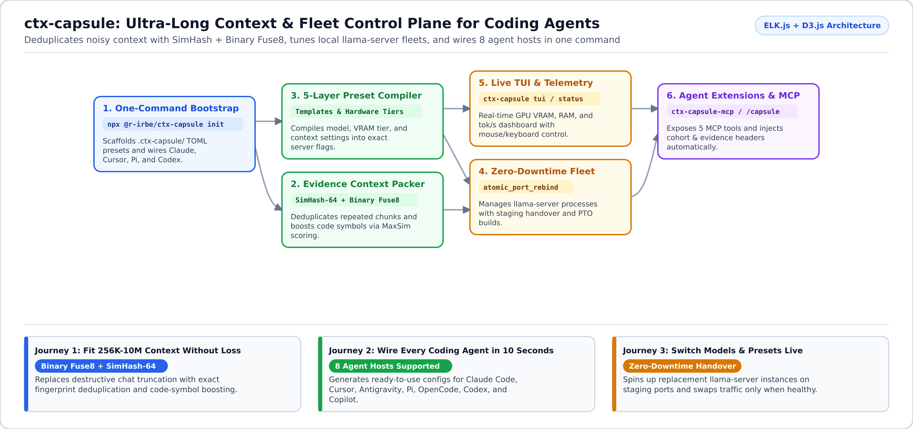

# `@r-irbe/ctx-capsule`

**Fit 256K to 10M tokens of repository context into your coding agents, manage local `llama-server` fleets without downtime, and wire every agent host in one command.**

`@r-irbe/ctx-capsule` is a TypeScript control plane, context deduplicator, and fleet manager for local [`llama.cpp`](https://github.com/ggerganov/llama.cpp) and [`llama.cpp-opt`](https://github.com/r-irbe/llama.cpp-opt) servers.



---

## Why Use `ctx-capsule`? (What Problem Does It Solve?)

When you point AI coding agents (Claude Code, Cursor, Pi, Antigravity, OpenCode, or Codex) at a large repository, three problems slow you down:

1. **Repeated files and tool logs blow up the context window**: Standard agents respond by running lossy chat summaries that forget exact variable names, file paths, and error messages. `ctx-capsule` packs context using fast *SimHash-64*[^simhash] and *Binary Fuse8*[^fuse8] fingerprints to strip duplicates while boosting exact code symbols.
2. **Every coding agent wants a different config file**: Wiring the same local model server across 6 or 8 different agent CLIs takes tedious manual JSON/TOML editing. `ctx-capsule init` configures all of them in a single command.
3. **Switching models or context sizes interrupts active work**: Restarting `llama-server` drops in-flight agent requests. `ctx-capsule` launches the new configuration on a staging port and swaps traffic only after health checks pass.

---

## Start in 2 Minutes

### 1. Initialize Your Workspace & Wire Your Coding Agents

Run one command in your repository root to generate `.ctx-capsule/config.toml` and wire your installed coding agents:

```bash
npx @r-irbe/ctx-capsule init \
  --target . \
  --agents pi,claude,antigravity,opencode,codex,copilot,weftd \
  --preset ds41-1017-np1-512k-max-speed \
  --model deepseek-v4.1-1017-ud-q4kxl
```

### 2. Inspect Fleet Status or Launch the Fullscreen TUI

```bash
# Print a single-screen status summary (active model, VRAM/RAM usage, resolved flags)
node --experimental-strip-types ./src/cli_entry.ts status

# Launch the interactive keyboard/mouse terminal dashboard
node --experimental-strip-types ./src/cli_entry.ts tui
```

---

## Adapt to Your Use Case (Customer Journeys)

<details open>
<summary><b>1. Coding With Massive Repositories (256K-10M Context Without Lossy Summaries)</b></summary>

- **Who this is for**: Engineers working across hundreds of source files where standard chat compaction forgets critical details.
- **Problem solved**: Instead of summarizing away your code, `capsule_pack_context` deduplicates repeated chunks and scores relevant code identifiers using *MaxSim*[^maxsim] token overlap.
- **How to use it**: Call the `capsule_pack_context` MCP tool from Claude Code, Cursor, or Antigravity, or load the native Pi extension (`@r-irbe/ctx-capsule/pi-extension`) which automatically disables lossy compaction when Fuse8 capsules are active.
</details>

<details>
<summary><b>2. Multi-Agent Teams Using Different IDEs & CLIs</b></summary>

- **Who this is for**: Developers or teams who switch between Claude Code, Cursor, Pi, OpenCode, Codex, and GitHub Copilot against a shared local inference server.
- **Problem solved**: Keeps model IDs, context limits, and MCP tool definitions synchronized across every tool.

| Agent Host | Generated / Synchronized Configuration File |
| :--- | :--- |
| **Pi** | `.pi/provider-capsule.json` + `.pi/extensions/ctx-capsule.json` |
| **Claude Code / Cursor / Antigravity** | `.mcp.json` (`mcpServers.ctx-capsule` -> `ctx-capsule-mcp`) |
| **OpenCode** | `opencode.json` (`provider.ctx_capsule` + `mcp.ctx-capsule`) |
| **Codex CLI** | `.codex/config.toml` (`model_providers.ctx_capsule` + `mcp_servers.ctx-capsule`) |
| **GitHub Copilot** | `.github/copilot-capsule.json` |
| **Weft (`weftd`)** | `.weft/capsule-bridge.json` |
</details>

<details>
<summary><b>3. Zero-Downtime Model Switching & Profile-Guided Server Builds</b></summary>

- **Who this is for**: Operators running local `llama-server` fleets who want to switch presets or recompile with Clang Profile-Targeted Optimization (`build-pto/bin/llama-server`) without dropping active sessions.
- **How to use it**: Use `/capsule preset <id>` in Pi or call `capsule_switch_preset` / `capsule_pto_tune` via MCP.
</details>

---

## Technical Reference & Architecture Details

<details>
<summary><b>View MCP Tools, Pi Extension API, and Hexagonal Architecture</b></summary>

### Universal Stdio MCP Server (`ctx-capsule-mcp`)
Exposes 5 zero-dependency tools over stdio JSON-RPC 2.0:
1. `capsule_status`: Active model, preset, VRAM/RAM metrics, and resolved `llama-server` CLI arguments.
2. `capsule_switch_preset`: Hot-swaps the active template (`templateId`) or model (`modelId`).
3. `capsule_pack_context`: Deduplicates chunks via 64-bit SimHash + Binary Fuse8 and ranks chunks with code-symbol boosting.
4. `capsule_sync_agents`: Re-synchronizes configuration files across any subset of supported agents.
5. `capsule_pto_tune`: Triggers Clang IRPGO + ThinLTO profile-guided builds (`dry_run` or `live`).

### Native Pi Extension (`@r-irbe/ctx-capsule/pi-extension`)
```ts
import registerCapsulePiExtension from "@r-irbe/ctx-capsule/pi-extension";

registerCapsulePiExtension(pi, {
  initialModelId: "deepseek-v4.1-1017-ud-q4kxl",
  initialTemplateId: "ds41-1017-np1-512k-max-speed",
});
```

### Codebase Layout & Verification
- `src/domain/`: Zero-exception domain core (`Result<T, DomainError>`), 5-layer TOML compiler, and `evidence_packer.ts`.
- `src/ports/` & `src/adapters/`: Fullscreen TUI adapter (`pi_tui_adapter.ts`), zero-downtime process manager, and live GPU/HTTP telemetry poller.
- Run verification: `npm test && npm run typecheck`.
</details>

## License

Apache-2.0

[^simhash]: **SimHash-64**: A fast locality-sensitive hash that gives similar text chunks nearly identical 64-bit fingerprints so near-duplicates can be spotted in nanoseconds.
[^fuse8]: **Binary Fuse8 Filter**: A compact probabilistic data structure (using ~1.125 bytes per entry) that tests whether a context chunk has already been seen.
[^maxsim]: **MaxSim Scoring**: A relevance ranking method that scores how strongly a chunk matches the exact function, class, and variable names in your query.
